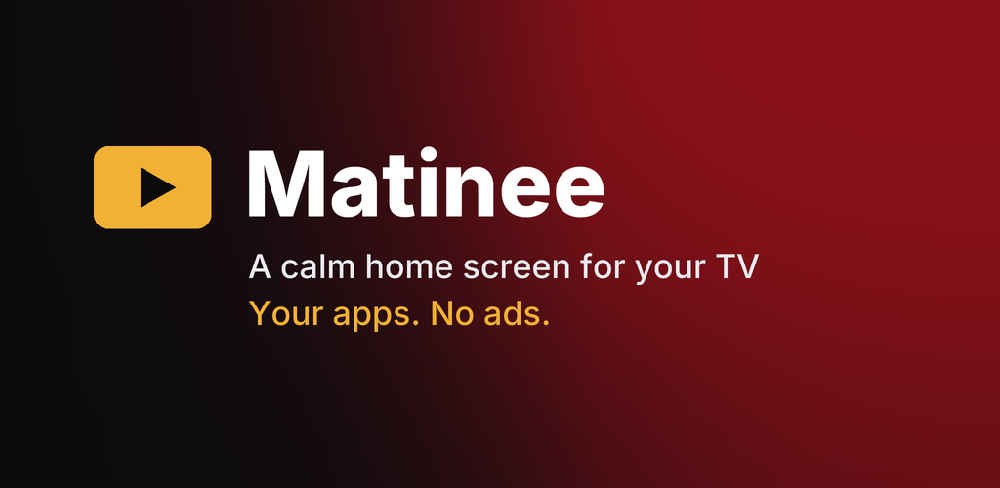
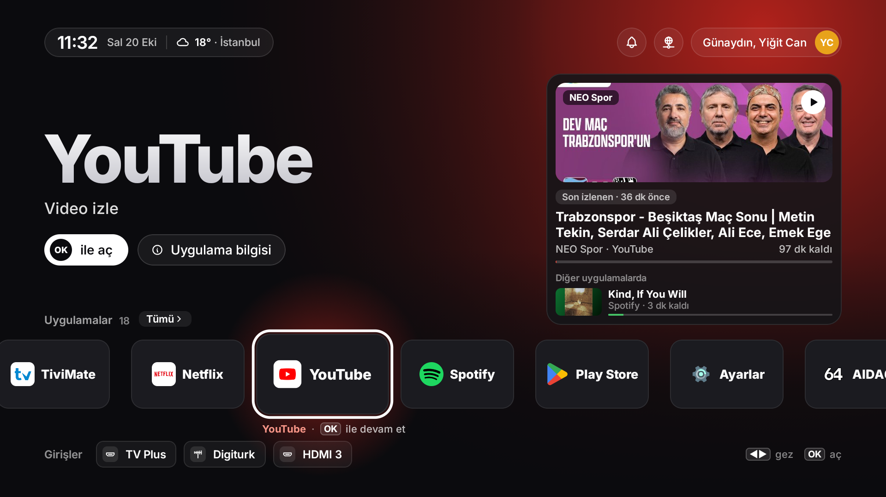
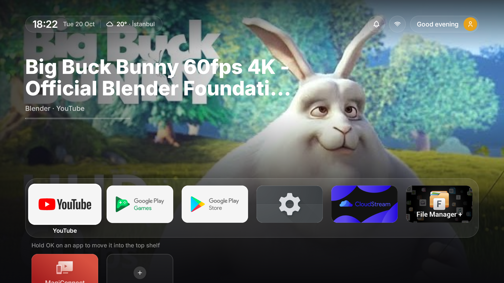
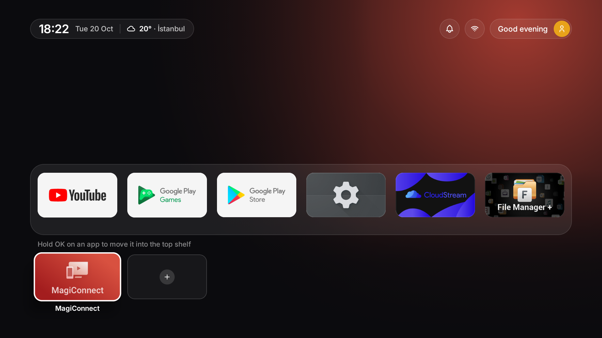
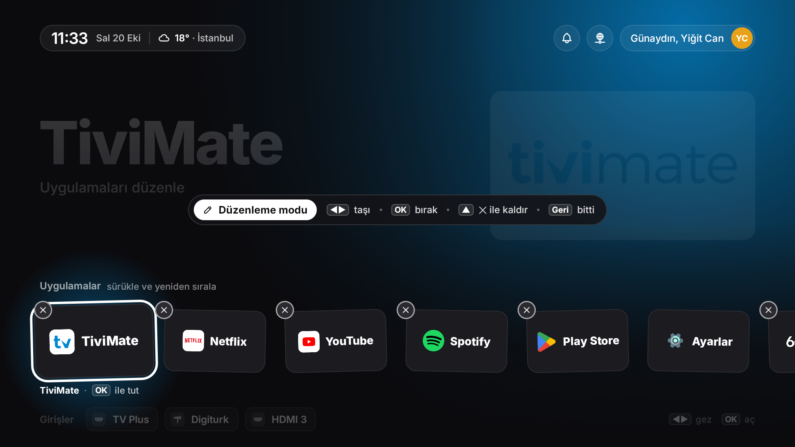
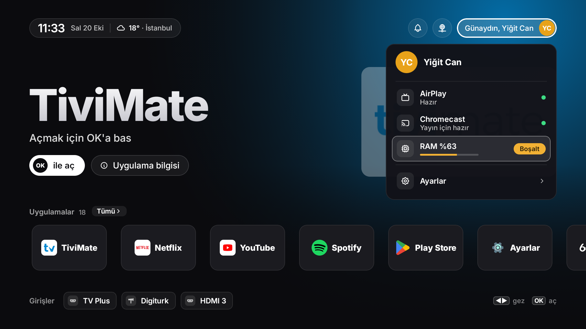
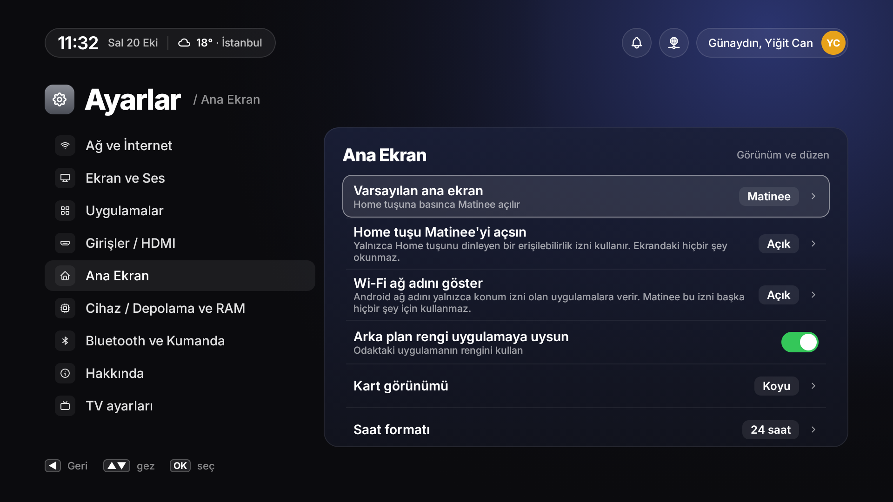

<p align="center">
  
</p>

<p align="center">
  A calm, ad-free home screen for Google TV and Android TV, built around your own apps.
</p>

<p align="center">
  <a href="https://play.google.com/apps/testing/com.yigitcan.matinee">Google Play (beta)</a> ·
  <a href="https://yigitech.dev/apps/matinee">Website</a> ·
  <a href="https://yigitech.dev/apps/matinee/privacy">Privacy</a>
</p>

---

Stock TV home screens fill most of the screen with promoted shows and ads. Matinee shows only the apps you installed, in the order you choose, and picks up where you left off.

## Two layouts

**Row.** The focused app's name sits large on the left, the screen takes on its colour, and your last played show appears on the right.



**Grid.** A favorites shelf with every other app below it. While the shelf has focus, the last played show fills the top of the screen.

| | |
|---|---|
|  |  |

Switch between them in **Settings → Home screen → Layout**.

## Features

- **Your apps, your order.** Hold OK on a card to move it or remove it. Phone-style apps that some TV boxes ship, such as satellite or IPTV players, can be added from the app list.
- **Last played.** Title, artwork and progress from apps that share their media session. Stored only on the TV.
- **HDMI inputs.** Each input shows the connected device's name and whether it is on or in standby (HDMI-CEC). Rename inputs and pick an icon.
- **At a glance.** Clock, weather for a city you choose, network name and a quick download speed test.
- **One bell.** Play Store updates and new-device alerts in one place.
- **Home button.** On TVs whose built-in launcher keeps the Home button, an optional accessibility service sends it to Matinee. It listens only for the Home key and never reads the screen.
- **English and Turkish**, switchable inside the app.
- **No account, no ads, no analytics.**

| Edit mode | Profile menu | Settings |
|---|---|---|
|  |  |  |

## Install

Matinee is in testing on Google Play:

1. Join the [matinee-testers](https://groups.google.com/g/matinee-testers) group with the Google account you use on your TV.
2. Open the [test link](https://play.google.com/apps/testing/com.yigitcan.matinee) and choose **Become a tester**.
3. Install Matinee on your TV from the Play Store.

Install from Google Play rather than an APK file: Android 13 and later block accessibility permissions for apps installed from a file, so the Home button option would not stay on.

Requires Google TV or Android TV 9 or later.

## Build

Kotlin and Jetpack Compose. You need JDK 17 or later and the Android SDK (compile SDK 35).

```bash
./gradlew assembleDebug
adb install app/build/outputs/apk/debug/app-debug.apk
```

Release builds are signed only when `~/.matinee-signing/keystore.properties` exists. See [play/RELEASE.md](play/RELEASE.md) for the release process and [DESIGN.md](DESIGN.md) for design decisions.

## License

[MIT](LICENSE) © Yiğit Can Polat · [yigitech.dev](https://yigitech.dev) · [x.com/yigitech](https://x.com/yigitech)
